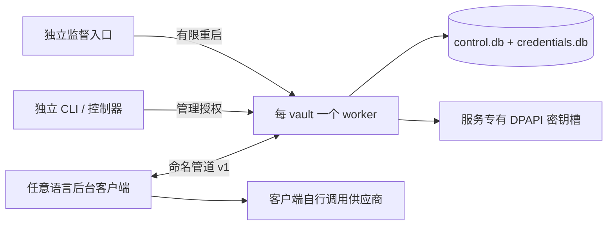

# Broker 架构与存储设计

组件 0.3.0 实现协议 1、API 3。服务负责共享库、授权和租约。各产品分别持久化本端的绑定、密钥与后端选择。

## 1. 边界与进程

broker 不解释 provider、OAuth、账号身份或 token 有效期。payload 为 base64url 编码的不透明字节，最大解码长度 1 MiB。内容类型与 payload 格式版本由客户端约定。没有 HTTP 监听器、供应商网络请求、产品库访问或产品运行依赖。

`brokerctl` 同时提供管理入口、前台 `serve` 与后台 `supervise`，三者复用 `BrokerService`。每个 vault 一个 worker；多个 vault 共用一份组件安装登记、组件管理锁与独立服务密钥目录。客户端数量不限定为两个产品。



OS 用户是本地安全边界。scopes 约束协议客户端，并不把同一 Windows 用户下的恶意进程变成隔离的安全主体：同用户进程若绕过协议直接读取该用户的 DPAPI 材料，仍拥有该用户权限。数据机密性和完整性由加密与认证保证，在线接入由 DPAPI CurrentUser、命名管道身份与协议授权约束；用户目录 ACL 不作为数据安全性的前提。Windows 提权级别也须与管道服务相容；跨提权接入不在本次验证范围。

## 2. 目录、身份与锁

### 平台边界与代码组织

所有 C# 项目以 `net10.0` 编译，CA1416 和 warnings-as-errors 保持启用。`Database`、`Vault`、`CredentialStore`、`BrokerService`、`ComponentManager`、协议服务/客户端与 CLI 都没有 Windows 平台标注或 OS 判断。仅 `Platform/Windows/` 中的内部实现类声明 `[SupportedOSPlatform("windows")]`；平台组合选择位于 `BrokerPlatform.SelectCurrent()`；共享 ComponentHost 内只有文件模式等实际需要分支的操作检查 OS，业务层不判断 OS。

`BrokerPlatform` 是不可变的五组能力组合，默认由 `BrokerPlatform.Current` 选择，也可由可信宿主显式传入 `Vault.Open(..., platform: ...)`、`new ComponentManager(..., platform: ...)` 和 `BrokerClient.Connect(..., platform: ...)`。Vault 持有同一组合，BrokerService 及 PipeServer 从该 Vault 使用它；控制器的管理客户端、登记校验、安装、恢复和子进程启动也使用控制器持有的组合。不存在全局可变 provider 切换，不由 RPC、renderer 或用户凭据指定实现。

| 接口 | 能力/关键 API | 当前实现范围 |
| --- | --- | --- |
| `IUserIdentity` | `CurrentUserId`，返回不透明的当前用户身份字符串 | `WindowsUserIdentity`，SID |
| `IPrivateFileSystem` | `CreateDataDirectory`、`CreatePrivateDirectory`、`RestrictCreatedFile`、路径校验 | `WindowsPrivateFileSystem`，读写探测、新建内容 DACL；DirectoryIdentity 仅用于诊断 |
| `ISecretProtector` | `Protect`、`Unprotect`、`FileExtension` | `WindowsSecretProtector`，DPAPI CurrentUser 与 `.dpapi` 槽后缀 |
| `ILocalTransport` | `Accept(address, cancellation)`、`Connect(address, cancellation)` 返回调用方拥有的 `Stream` | `Shared/NamedPipeTransport`，Windows/Linux/macOS 共享的字节模式管道，双端 CurrentUserOnly，取消/失败释放未交付句柄 |
| `IComponentHost` | RID、默认 home、EXE/必需资产、路径比较/文件名策略、当前进程身份、独立启动、worker/tool 运行、存活检查、核验后终止 | `Shared/ComponentHost`，共用进程管理；ComponentHostProfile 提供三个系统的文件/目录/路径策略，启动处分支 |

`Storage/LocalFiles` 只封装平台中立的路径检查、原子写入和独占打开，不声称建立 OS 权限边界；SQLite 包装器使用这些托管机制。新建内部内容的权限及用户目录的读写探测由 `IPrivateFileSystem` 实现；已有内容不逐项验证 ACL，物理身份不参与 vault 授权。协议编解码、双向 HMAC 认证、请求分发、超时、租约和数据库事务均保留在中立层，不迁入平台适配。

### 共享命名管道传输

NamedPipeServerStream/NamedPipeClientStream 本身支持 Windows 和 Unix，当前适配采用 Byte 模式、异步 IO 和双端 CurrentUserOnly，没有 Windows ACL/PipeAccessRights 重载，因此不带 Windows 标注，也不复制 Linux/macOS 专用实现。Windows 使用系统命名管道；.NET 在 Unix 侧使用 Unix domain socket，CurrentUserOnly 在两端校验有效用户身份。Windows 的该选项还包含提权级别约束，不能将平台安全细节视为完全相同。

Unix 不支持 Message 模式，但本协议自己用 4 字节长度前缀分帧，不依赖该模式。ILocalTransport 保留为传输/协议隔离边界，并不表示每个 OS 都要重写一份传输。工厂在 Windows、Linux、macOS 都选择共享 NamedPipeTransport；其他尚无支持的系统或宿主显式注入的缺失传输仍使用专门的缺失能力错误。Linux/macOS 的用户身份、私有存储和密钥保护适配仍待实现，传输可复用不代表完整服务已交付。

依据：[.NET Unix NamedPipe 服务端实现](https://github.com/dotnet/runtime/blob/v10.0.0/src/libraries/System.IO.Pipes/src/System/IO/Pipes/NamedPipeServerStream.Unix.cs)、[客户端实现](https://github.com/dotnet/runtime/blob/v10.0.0/src/libraries/System.IO.Pipes/src/System/IO/Pipes/NamedPipeClientStream.Unix.cs)与 [PipeOptions 文档](https://learn.microsoft.com/en-us/dotnet/api/system.io.pipes.pipeoptions?view=net-10.0)。

### 共享组件宿主

ComponentHost 使用 .NET Process API 共用当前进程身份、PID/创建时间存活校验、核验 EXE 后终止、等待 worker、60 秒工具探测超时及安全输出处理。没有整类 Windows 标注；ComponentHostProfile 只负责平台资产与路径策略，工厂传入实际 RuntimeInformation.RuntimeIdentifier，保留 linux-musl 等 RID，不能仅拼接 OS 和 CPU 而丢失 libc 类型。

| 项目 | Windows | Linux | macOS |
| --- | --- | --- | --- |
| apphost | brokerctl.exe | brokerctl | brokerctl |
| 原生库 | hostfxr.dll 等 | libhostfxr.so 等 | libhostfxr.dylib 等 |
| 托管程序集 | brokerctl.dll、System.Private.CoreLib.dll | 相同 | 相同 |
| 默认 home | LocalApplicationData/AstraCredentialBroker/v1 | 绝对 XDG_DATA_HOME/AstraCredentialBroker/v1，否则 ~/.local/share/AstraCredentialBroker/v1 | ~/Library/Application Support/AstraCredentialBroker/v1 |
| 路径比较 | OrdinalIgnoreCase | Ordinal | Ordinal，保守处理可能区分大小写的卷 |
| 独立监督启动 | 已验收的 UseShellExecute + Hidden | nohup + 固定 shell stdio 重定向 + exec | 相同 Unix 分支 |
| 普通 worker/探测 | 直接 Process.Start，输出由监督/控制器消费 | 相同 | 相同 |

必需原生资产包括 hostfxr、hostpolicy、coreclr、e_sqlite3，按平台加前后缀；.dll 托管程序集名称不随 OS 改为 .so/.dylib。Unix 文件名策略不套用 Windows 的冒号/问号限制；manifest 为避免歧义仍拒绝两种分隔符、NUL、空名与点段。Linux 忽略相对 XDG_DATA_HOME，遵循 [XDG 目录规范](https://specifications.freedesktop.org/basedir-spec/latest/)。

Unix 后台启动使用 /usr/bin/nohup 和 /bin/sh；固定 shell 程序只有 `exec </dev/null >/dev/null 2>&1; exec "$@"`。EXE 和所有参数独立放入 ArgumentList 的位置参数，不拼接到 shell 源码。启动 nohup 时重定向三路 stdio，使其不因继承终端输出而生成 nohup.out；shell 在 exec supervisor 前将三路改为 /dev/null，控制器退出不保留其标准管道。nohup 处理 SIGHUP，不注册 systemd/launchd 或登录自启，也不声称创建了新 POSIX session。系统缺少这些工具时明确报 detached-launcher-unavailable。

IComponentHost.PrepareCopiedFile 在复制每个组件文件后调用。Windows 不调整 ACL 或文件模式；Unix 保留源文件普通权限位，去掉 setuid/setgid/sticky，给 brokerctl apphost 补 owner execute，避免复制后无法探测/启动。私有 home 的用户隔离仍由 IPrivateFileSystem 保证，执行位处理不替代目录权限实现。

CurrentProcess/IsProcessAlive/TerminateVerified 的 PID 与创建时间约束保持不变，终止前还需按本平台路径策略匹配已登记 EXE。启动与子进程收尾是共享实现；平台 profile 本身不改变租约、generation、排空、重启预算或安装日志事务。当前仅在 Windows 执行了真实生命周期验收；Linux/macOS 的布局/参数策略已测试，真实启动、信号、退出和模式行为仍需对应主机运行。

### 缺失能力的错误语义

工厂按已实现的能力逐项组合，Linux/macOS 使用共享命名管道与组件宿主，并将尚缺的用户身份/私有存储/密钥保护连接到 UnavailablePlatform；不在选择时抛出全局 Windows-only 错误。只有调用缺失能力才抛出 `PlatformFeatureUnavailableException(feature, platform)`；feature 取 `user-identity`、`private-file-system`、`secret-protection`、`local-transport` 或 `component-host`。CLI 返回以下结构至 stderr，并以 1 退出：

```json
{
  "error": "platform-feature-unavailable",
  "feature": "secret-protection",
  "platform": "linux",
  "message": "Platform feature 'secret-protection' is not implemented for 'linux'."
}
```

该示例说明错误结构，不代表已实现 Linux 服务。协议错误仍只返回稳定 error 字符串 `platform-feature-unavailable`，保持 v1 DTO/schema；库调用方可读取异常的 Feature/Platform。缺失实现不会被当成 LOCKED、未安装、安装损坏或网络暂时断开来自动恢复，也不会回退明文密钥、宽权限目录或未认证传输。协议、JCS、迁移包、schema 生成与 CLI help 不需要解析这些能力，因此可以独立使用。Windows x64 的两个发布/验收脚本是特定产物的工作流，脚本入口可以明确拒绝其他宿主；这不影响中立库/CLI 命令。

当前工厂只提供 Windows 的完整生产组合；未来平台可逐项实现接口并在工厂组合。接口实现属于可信执行代码，测试替身仅位于 test/，不被当作生产安全实现。`PlatformTests` 使用不同用户身份、不同密钥槽后缀及测试保护器，实际运行初始化、租约提交和重开读取，证明业务层不依赖 SID、DPAPI、管道或组件宿主。

### 兼容现有 Windows 数据

Windows 的用户 ID、DPAPI entropy、槽文件名、目录身份编码、默认 home、命名管道名和协议/存储版本保持 v1。manifest/登记的 `ownerSid` 与端点的 `pipeName` 是保留的 v1 字段名：业务层将前者视为接口提供的不透明身份，将后者视为本地传输地址；没有在业务层解析 SID 或操作 Windows 管道对象。更换 OS 适配不是直接复制旧 OS 密钥槽的数据迁移方案。

### 目录布局

服务 home 默认 `%LOCALAPPDATA%\AstraCredentialBroker\v1`，可以在独立 CLI 中显式指定。它与 vault 数据目录不能相互包含。产品目录不参与定位。

```text
service-home/
  component.lock                    # 当前用户组件管理互斥
  installation.json                 # 当前可用安装、版本、清单摘要
  install-journal.json               # 安装/卸载恢复日志，仅进行中存在
  maintenance.json                  # 禁止新启动的维护标志
  components/<version>-<unique>/     # 完整复制的自包含目录
  vaults/<vaultId>.json              # 位置、逻辑用户身份及启动登记
  keys/<vaultId>.admin.dpapi         # 管理接入材料
  keys/<vaultId>.<keyId>.dpapi        # broker 自有存储主密钥
  keys/<vaultId>.delivery.dpapi      # 初次密钥交付恢复槽；确认交付后删除

vault/
  manifest.json                     # layoutVersion、vaultId、ownerSid、directoryIdentity
  control.db                        # 唯一 currentVersion、更新权、客户端授权与控制回执
  versions/<storageVersion>/
    version.json                    # attemptId、keyId、迁移包摘要与主密钥认证检查
    migration.json                  # 初始迁移包
    credentials.db                  # 活动密文、更新操作、fence 与事件
  runtime/
    vault.lock                      # FileShare.None，唯一共享库写入实例
    supervisor.lock                 # 唯一监督实例
    endpoint.json                   # PID、进程创建时间、generation、管道名与最近状态
```

用户所选根目录保留原 ACL 和属主，不逐项拒绝已有文件权限。broker 对自身新建的内部目录、文件、WAL 和临时文件设置当前 SID 与 SYSTEM 权限，并检查实际读写能力；保持规范化本地路径及重解析点检查。安装复制仍拒绝符号链接、目录联接、目录穿越、重复路径及额外文件。

旧版 manifest 和登记中的 DirectoryIdentity 字段兼容读取，新建时为空，不再参与校验。停服后复制/还原的完整 vault 使用逻辑 vaultId 和加密认证校验，不绑定文件系统 ID。PID 同时绑定进程创建时间，防止 PID 复用造成误判。OS 独占锁始终独立于租约，endpoint 文件不是写入锁。

### WindowsPrivateFileSystem 的直接原生调用

`Platform/Windows/WindowsPrivateFileSystem.cs` 只有两个直接 P/Invoke 声明，集中在 `DirectoryIdentity` 使用。SID、ACL、DPAPI 使用各自 Windows 实现中的 .NET API；原子写入和文件锁在平台中立的 LocalFiles 中，没有自行编写原生绑定。

| 原生 API | 参数与行为 | 用途 |
| --- | --- | --- |
| `CreateFileW` | access=0；共享 Read/Write/Delete；`OPEN_EXISTING`；`FILE_FLAG_BACKUP_SEMANTICS \| FILE_FLAG_OPEN_REPARSE_POINT` | 只打开现有目录取得元数据句柄；不创建、截断或读取目录内容 |
| `GetFileInformationByHandle` | 使用上述句柄，一次读取 `BY_HANDLE_FILE_INFORMATION` | 校验实际对象为目录且不是重解析点，取卷序列号与 FileIndex，序列化成 `xxxxxxxx:xxxxxxxxxxxxxxxx` |

Windows 打开目录句柄要求 `FILE_FLAG_BACKUP_SEMANTICS`，这个标志本身不授予或启用备份特权。最后一级的重解析点通过 `OPEN_REPARSE_POINT` 打开后被拒绝；祖先重解析点也由现有路径检查拒绝。句柄由 `SafeFileHandle` 确定性释放，不存在手工分配的非托管缓冲区，不需要 unsafe 代码。

这两项调用目前只保留为诊断辅助，不用于创建、打开或登记 vault。物理目录身份不是密钥或授权依据；新建 manifest 的兼容字段为空，普通复制、移动、备份和还原不会因文件系统 ID 改变被拒绝。

API 语义参见 [CreateFileW](https://learn.microsoft.com/en-us/windows/win32/api/fileapi/nf-fileapi-createfilew) 和 [GetFileInformationByHandle](https://learn.microsoft.com/en-us/windows/win32/api/fileapi/nf-fileapi-getfileinformationbyhandle)。

## 3. 控制库结构

`control.db` 使用 WAL、`synchronous=FULL`、外键与 5 秒 busy timeout。只在持有 vault OS 锁的服务/短时管理上下文中打开。

| 表 | 主键与字段 | 作用 |
| --- | --- | --- |
| `settings` | `key → value` | `schemaVersion`、唯一 `currentVersion`、`sourceClientId`、`sourceWatermark`、`ownership`、`deliveryAcknowledged` |
| `receipts` | `operation_id`；`kind, client_id, request_hash, result` | 初始化、客户端准备与更新权移交的持久回执；不保存迁移密钥 |
| `clients` | `client_id`；`grant_json, revoked` | 稳定客户端 ID、令牌验证材料、scopes、记录白名单、allCredentials |
| `ready` | `client_id`；`storage_version, watermark` | 持有正确主密钥的客户端对初始版本的准备确认 |
| `challenges` | `id`；`client_id, nonce, expires_at, consumed` | 60 秒一次性准备挑战，绑定客户端 |

`ClientGrant = { clientId, tokenHash, scopes: string[], credentialIds: string[], allCredentials: boolean }`。tokenHash 是随机 32 字节接入令牌的 SHA-256，参与挑战证明，不是供应商 token。授权只由独立管理通道创建；历史客户端 ID 保留，不能通过重复登记静默替换身份。撤销后旧会话在下一次请求被拒绝。

## 4. 凭据库结构

| 表 | 主要字段 | 作用 |
| --- | --- | --- |
| `records` | `id, revision, created, updated, group_key, fence, sealed, deleted` | 记录修订、归属及完整加密正文；删除保留墓碑 |
| `groups` | `group_key, fence` | 记录或显式授权族的持久 fence |
| `operations` | `sequence, id, group_key, begin_hash, state, json` | 公平队列、完整租约/结果事实和幂等索引 |
| `mutations` | `id, client_id, request_hash, revision, credential_id` | 创建记录的幂等索引 |
| `events` | `sequence, credential_id, revision, kind` | 事务内变更日志，可按游标补取 |
| `clock` | `id=1, watermark` | 已观察服务时间水位，重启不把时间倒退到更早位置 |

修订在 SQLite 中为有符号 64 位非负整数，在协议中为规范十进制字符串。fence 与 eventSequence 同样以字符串传输，避免 JavaScript 精度丢失。当前版本数据库 `PRAGMA user_version=1`，缺失或不兼容数据库拒绝打开，不自动建立空库。

加密正文 `RecordBody = { contentType, payloadFormatVersion, payload, metadata }`。`sealed = { nonce, ciphertext, tag }`。AAD 绑定格式、vault/version/attempt/key、credentialId、revision、两个归属字段、互斥组和删除状态。明文正文仅在当前请求处理期间存在，broker 的持久内存仅保存服务主密钥和协调状态。

metadata 是区分大小写的单层字符串映射，最多 64 对，键最多 128 UTF-8 字节，值最多 1 KiB，规范 JSON 总编码最多 16 KiB。拒绝 null、数字、布尔值、数组和嵌套对象，不解释字符串中的 JSON。补丁按键设置、按 `removeKeys` 删除，未知扩展保留。`"true"`、`"TRUE"` 与 `" true "` 不等价。

列表在获准记录内应用创建者、最近更新者及 metadataEquals 的 AND 过滤，按 credentialId 的二进制顺序稳定分页。服务内部解密用于筛选；只返回描述，不把全部秘密发给客户端。描述声明不替代读取授权或应用的 provider 能力校验。

## 5. 密码格式与互操作

活动记录与迁移包都使用 AES-256-GCM：32 字节密钥、12 字节随机 nonce、16 字节 tag。新 nonce 使用系统 CSPRNG，不从身份或修订派生。服务主密钥与迁移密钥独立随机生成。

迁移密钥编码为 `acm1_` 加 43 字符无填充 base64url，合计 48 字符。通过 HKDF-SHA-256，使用 32 字节 salt 与规范 info 派生 32 字节包密钥：

```text
info = UTF8(JCS(["astraconductor.credential-transfer.v1",
                vaultId, storageVersion, attemptId, transferId]))
K = HKDF-SHA-256(migrationKey, salt, info, 32)
AAD = UTF8(JCS(header))
plaintext = UTF8(JCS(snapshot))
```

header 显式包含 format/version/vaultId/storageVersion/attemptId/transferId/keyId、cipher、kdf 与 payloadSchemaVersion。所有参数认证，算法和长度按白名单校验，拒绝未知字段、重复属性、错误 info、非规范 base64url 和超限输入；认证失败不返回明文。

snapshot 包含同一版本身份、主密钥及初始 `Credential[]` 快照。活动记录正常刷新不会重写迁移包；以后新客户端仍可从初始包验证主密钥，再读取 broker 当前记录。当前阶段不实现成功版本的重新导出或换钥。

实现的 JCS 域限制为对象/数组/字符串/布尔/null/安全整数。属性按 UTF-16 code unit 排序，字符串采用 ECMAScript JSON 转义，保留 Unicode 与 U+2028/U+2029，拒绝无配对代理项；协议不使用浮点数。跨语言测试包括 RFC 5869 HKDF、NIST AES-GCM、JavaScript 生成并由 .NET 解密、.NET 生成并由 JavaScript 解密。

仓库内的 `test/vectors/transfer-v1.json` 采用纯 ASCII JSON 表示，非 ASCII 字符统一写为 `\uXXXX`，包括 U+2028/U+2029 和非 BMP 字符的代理对。解析后的字符和认证字节保持原协议含义；fixture 的展示转义不改变 JCS 线上编码。生成器确定性重建明文、密文和 tag，并立即做认证解密验证；.NET 测试还显式检查包含这些字符的 metadata，以发现编辑中误删不可见字符的问题。

DPAPI 使用 CurrentUser，每个用途的 entropy 包含 broker 格式标识和相应 vault/version/attempt/key 身份。版本 `keyCheck` 以独立 AAD 加密固定检查文本，因此空 vault 也可以可靠拒绝错误主密钥。密钥暂不可用进入 LOCKED，不回落明文。

## 6. 发布、交付与本端接入

API 3 的 `publish` 接受具备 initialize 权限的当前客户端提交的操作 ID、来源水位与完整记录。broker 生成独立版本、尝试 ID 与主密钥，验证加密记录、迁移包、版本清单和系统保护钥槽的回读结果，再在 control.db 同一事务提交 currentVersion、来源、水位、`ownership=broker` 和无秘密回执。

调用者按原 operationId 查询或重试；请求摘要或提交者不同会产生冲突。未确认交付的来源可通过 `recoverDelivery` 取回迁移密钥，确认后移除交付槽。各产品用迁移密钥解密版本、保存自己的绑定，再由用户选择启用共享读写。另一端的运行状态、准备与交付确认均无需参与。

旧 API 的 `initialize` 仍发布 `ownership=source` 版本，该路径须按旧协议 prepareClient/handoff 才能切换写入权。升级组件保留已有版本及回执。

## 7. 更新许可与故障边界

客户端流程是 beginUpdate → 收到 granted 与当前 payload → markUpdateStarted 持久化确认 → 自行调用供应商 → commitUpdate 或 abortUpdate。已过时观察修订返回 stale 与当前记录，不能先调用供应商再申请许可。

operations 的状态是 `queued → granted → started → committed / failed-released / expired`；队列还可因会话退出或排队超限成为 cancelled，观察修订不一致成为 stale。每个互斥组按入队 sequence 排序；queued 客户端用同一请求轮询，不能越过更早等待者。排队最长 120 秒，弃置等待者不会永久堵队。

每条记录默认独立互斥，也可在创建时声明 coordinationKey，同一显式族共同排队。服务不解析 payload 推测供应商授权族，coordinationKey 创建后固定。

许可包含 operationId、clientId/instanceId、leaseId、fence、generation、baseRevision、grantedAt/expiresAt/hardDeadline。TTL 为 30 秒，建议每 10 秒续期，总占用最长 120 秒。每次 begin/renew/commit 都在事务内检查期限，清理定时器不是正确性的前提。

commit 校验当前有效许可、服务代次、修订与所有归属信息；payload、metadata、最近更新者、revision、操作成功回执和 credentialChanged 事件同事务提交。重复成功提交只返回原回执，不递增修订；不同结果的同 operationId 报冲突。

abortUpdate 接受固定 failureCode、retryable 和 unchanged/unknown；失败立即释放，无论上游结果是否 unknown 都不保留永久锁。重复失败返回原失败回执，已成功提交的迟到失败返回成功，过期旧操作不释放接替者的许可。失败重试必须新建 operationId。

临时断线保留原许可。服务重启保留原截止时间并更换 generation；相同 clientId/instanceId 用原 begin 请求重新查询许可，取得新 generation 后才可继续，旧代次提交被拒绝。重启不延长 TTL 或 hardDeadline。

运行期服务时间取单调经过时间和 UTC 的最大值，事务持久化水位；恢复时把单调基点推进到已有水位。系统时钟在停机期间被恶意修改的情况不提供可信时间保证。fence 约束本地提交，不保证供应商远端 exactly-once，也不防整库恶意回滚。

## 8. 会话、通知与生命周期

会话由稳定 clientId 与逻辑 instanceId 标识，普通请求或 heartbeat 延长 45 秒会话期限。重连须复用逻辑 instanceId 才能继续原操作。断开只清理该实例的排队请求，有效许可仍按原 TTL 处理；不会停止其他客户端。

事件只包含 credentialId/revision/eventSequence/kind，不带 payload 或 metadata。getEvents 支持游标补取，watchEvents 提供最长 5 秒的长轮询，提交后广播唤醒全部等待者。事件只在授权范围返回，未授权事件仍可推进本客户端的扫描游标。客户端必须按 revision 去重并重读当前值，不能用乱序事件覆写较新快照。

STOPPED/STARTING/FAILED 由控制器与运行登记报告；工作进程报告 LOCKED/READY/IDLE/DRAINING。READY 不等于已接管，ownership 单独报告。没有会话与有效在途许可时进入 IDLE，60 秒后退出；待处理许可仅保留至原截止时间。显式管理停止拒绝新许可，允许原许可提交/失败释放，最长排空 30 秒后持久化事实退出。

主应用退出、卸载或切回私有不会移除服务密钥。独立组件卸载只删除运行组件和启动登记，保留 vault、授权、主密钥及回执。安装恢复的具体流程见 [安装文档](installation.md)。

### 空闲维护的写入边界（2026-11-05）

服务的 200 ms ticker 在没有 granted/started/queued 操作时，HasPending 仅执行存在性查询，不启动写事务、不更新 clock。断开没有该客户端排队票据的连接也不写入。存在活动操作时继续使用原事务中的过期/fence/时钟水位处理；不是关闭 durable clock 或 SQLite synchronous=FULL。这样服务等待会话超时、空闲退出期间不会仅因轮询不断追加 WAL。回归覆盖无业务空闲检查、管理断开、WAL 大小和 data_version 不变，以及活动租约过期与迟到提交拒绝。
